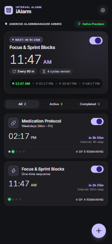
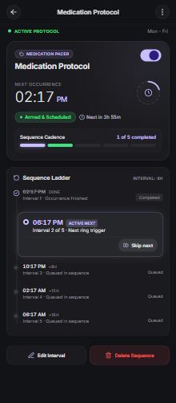
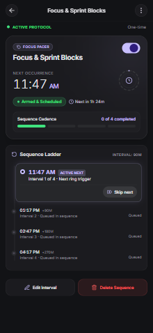

<div align="center">


# iAlarm (Interval Alarm)

**Atomic, offline-first Android interval alarm utility with zero background battery drain.**

[](https://react.dev/)
[](https://www.typescriptlang.org/)
[](https://tailwindcss.com/)
[](https://tauri.app/)
[](https://www.rust-lang.org/)
[](https://developer.android.com/)
[](https://pnpm.io/)
[](LICENSE)

<p align="center">
  <a href="#app-showcase">App Showcase</a> •
  <a href="#key-features">Key Features</a> •
  <a href="#technology-stack">Tech Stack</a> •
  <a href="#getting-started">Getting Started</a> •
  <a href="#building-the-android-apk">Build APK</a> •
  <a href="#license">License</a>
</p>

</div>

---

## App Showcase

<div align="center">

| Home Overview | Sequence Configuration | Cadence & Sound Audition |
|:---:|:---:|:---:|
|  |  |  |

</div>

---

## Overview

Interval Alarm enables users to create a single alarm sequence that automatically schedules multiple occurrences at fixed intervals from a chosen anchor time, without requiring multiple alarms to be configured manually.

- **Application Name:** iAlarm
- **Full Brand Name:** Interval Alarm
- **Package Identifier:** `com.intervalalarm.alarm`

---

## Key Features

- **Automated Fixed-Interval Scheduling**: Schedules occurrences deterministically based on the formula `occurrence(n) = start_time + (n * interval)`.
- **Multi-Day and Midnight Rollover**: Sequences seamlessly traverse midnight and span multiple calendar days.
- **Recurrence Modes**: Supports One-Time, Daily, Selected Weekdays, and Continuous sequence repetition.
- **Native Android AlarmManager Integration**: Alarms are registered as exact alarm clocks via Android's `setAlarmClock` API, displaying the system alarm icon and waking the device from Doze mode.
- **Zero-WebView Background Dependency**: Active sequences are mirrored to Android `SharedPreferences`. If the application process is terminated or the phone reboots, alarms trigger and advance headlessly via native broadcast receivers.
- **Lock-Screen Full-Screen Intent Presentation**: Uses `SCREEN_BRIGHT_WAKE_LOCK`, `ACQUIRE_CAUSES_WAKEUP`, and `setShowWhenLocked` to illuminate the screen and present a dismiss/snooze interface over the keyguard.
- **Bundled Custom Ringtones & Haptics**: Ships with 12 built-in audio tracks (defaulting to *Best Android*) with synced haptic motor vibration patterns and fallback to system alarm ringtones.
- **Isolated Snooze Architecture**: Snoozing creates a temporary occurrence without altering the master sequence interval grid.
- **Downtime and Past-Occurrence Handling**: Expired occurrences from system downtime or battery depletion are skipped cleanly, targeting the next valid future occurrence.
- **Circadian Luxury Interface**: Built with TailwindCSS v4 using a dark obsidian palette (`#121316`), electric lavender accents (`#c8bfff`), cadence emerald (`#40e17e`), and tabular digital clock readouts.

---

## Technology Stack

| Layer | Technologies |
|---|---|
| **Frontend** | [React 19](https://react.dev/), [TypeScript](https://www.typescriptlang.org/), [TailwindCSS v4](https://tailwindcss.com/), [Vite](https://vitejs.dev/), [Lucide Icons](https://lucide.dev/) |
| **Desktop / Core Bridge** | [Tauri 2](https://tauri.app/) runtime, [Rust](https://www.rust-lang.org/), `chrono`, `uuid`, atomic file persistence |
| **Android Native** | [Kotlin](https://kotlinlang.org/), `AlarmManager`, `BroadcastReceiver`, `WakeLock`, `NotificationManager`, `AudioAttributes` |
| **Package & Build Toolchain** | [pnpm](https://pnpm.io/) v9+, Gradle 9.6.1, Android SDK (API 24 to 35), Android NDK 30, Rust Android target `aarch64-linux-android` |

---

## Project Structure

```text
iAlarm/
├── images/                         # Product and interface showcase previews
│   ├── home_page.png               # Active sequences dashboard
│   ├── schedule_page_01.png        # Time and cadence picker
│   └── schedule_page_02.png        # Live preview and tone audition
├── docs/                           # Comprehensive technical documentation
│   ├── system.md                   # System requirements, permissions, and lifecycle
│   ├── architecture.md             # Architecture diagrams, data flow, and components
│   ├── product.md                  # Product specifications, formulas, and use cases
│   ├── design.md                   # Stitch visual design system, colors, and layout
│   └── brand.md                    # Brand guidelines, naming conventions, and voice
├── src/                            # React frontend application
│   ├── assets/                     # SVG brand assets and bundled .ogg ringtones
│   ├── components/                 # UI views (HomeOverview, CreateAlarmModal, SettingsView, etc.)
│   ├── services/                   # AlarmApi Tauri invoke and native plugin bridge
│   ├── types/                      # TypeScript domain models and interfaces
│   ├── App.tsx                     # Main application entry point and state coordination
│   └── App.css                     # Theme tokens and TailwindCSS v4 imports
├── src-tauri/                      # Rust backend engine
│   ├── src/
│   │   ├── android_bridge.rs       # JNI and mobile plugin communication wrapper
│   │   ├── commands.rs             # Tauri IPC command definitions
│   │   ├── models.rs               # Strongly typed sequence and settings structs
│   │   ├── scheduler.rs            # Deterministic interval calculation engine
│   │   ├── storage.rs              # Atomic file I/O and schema versioning
│   │   └── lib.rs                  # Application runtime and plugin registration
│   ├── capabilities/               # Tauri 2 security permissions
│   ├── tauri.conf.json             # Tauri configuration (iAlarm / com.intervalalarm.alarm)
│   └── gen/android/                # Android Gradle project and native Kotlin source
│       └── app/src/main/
│           ├── AndroidManifest.xml # Permissions, activities, and broadcast receivers
│           ├── res/raw/            # Bundled custom raw ringtones (.ogg)
│           └── java/com/intervalalarm/alarm/
│               ├── AlarmActionReceiver.kt  # Notification action handler
│               ├── AlarmPlugin.kt          # Tauri 2 Android native plugin
│               ├── AlarmReceiver.kt        # AlarmManager broadcast receiver
│               ├── AlarmRingingActivity.kt # Lock-screen ringing UI activity
│               ├── AlarmScheduler.kt       # Native exact alarm scheduling engine
│               ├── BootReceiver.kt         # System reboot and time-change recovery
│               ├── MainActivity.kt         # Main application activity and runtime permissions
│               ├── NativeStorage.kt        # SharedPreferences persistence engine
│               └── RingtonePlayer.kt       # Audio and vibration hardware coordinator
```

---

## Getting Started

### Prerequisites

- **Node.js**: `v18.0.0` or higher
- **pnpm**: `v9.0.0` or higher (`npm install -g pnpm`)
- **Rust**: Latest stable toolchain with `aarch64-linux-android` target
  ```bash
  rustup target add aarch64-linux-android
  ```
- **Android SDK & NDK**: Command-line tools, platform SDK (API 34/35), and NDK (version 26+ or 30). Ensure `ANDROID_HOME` and `NDK_HOME` environment variables are configured.
- **Java Development Kit**: JDK 17 or JDK 21 (e.g., Android Studio JBR).

### Installation

Clone the repository and install frontend dependencies using `pnpm`:

```bash
git clone https://github.com/carlodandan/iAlarm.git
cd iAlarm
pnpm install
```

---

## Verification & Testing

### Rust Domain Unit Tests

Run the test suite verifying interval math, rollover, snooze isolation, and recovery:

```bash
cd src-tauri
cargo test
```

### Android Target Check

Verify that the Rust library compiles cleanly for the Android target:

```bash
cd src-tauri
cargo check --target aarch64-linux-android
```

### Frontend TypeScript Check & Bundle

Run type-checking and production bundling:

```bash
pnpm build
```

---

## Building the Android APK

To assemble the universal debug APK for Android:

```bash
pnpm tauri android build --target aarch64 --debug --apk
```

The output package will be generated at:
```text
src-tauri/gen/android/app/build/outputs/apk/universal/debug/app-universal-debug.apk
```

### Installing via ADB

To install and launch on a connected physical device or emulator:

```bash
adb install -r "src-tauri/gen/android/app/build/outputs/apk/universal/debug/app-universal-debug.apk"
adb shell am start -n com.intervalalarm.alarm/com.intervalalarm.alarm.MainActivity
```

---

## Documentation

Full documentation is available in the `docs/` directory:

- [System Documentation](docs/system.md): Android permissions, exact alarms, system recovery, and battery optimization rules.
- [Architecture Documentation](docs/architecture.md): Component diagrams, data flows, scheduler algorithms, and bridge mechanics.
- [Product Documentation](docs/product.md): Value proposition, sequence lifecycles, and use cases.
- [Design Documentation](docs/design.md): Circadian design tokens, color palette, typography, and UI specifications.
- [Brand Documentation](docs/brand.md): Naming architecture, brand voice, and identity standards.

---

## License

This project is licensed under the [MIT License](LICENSE).
