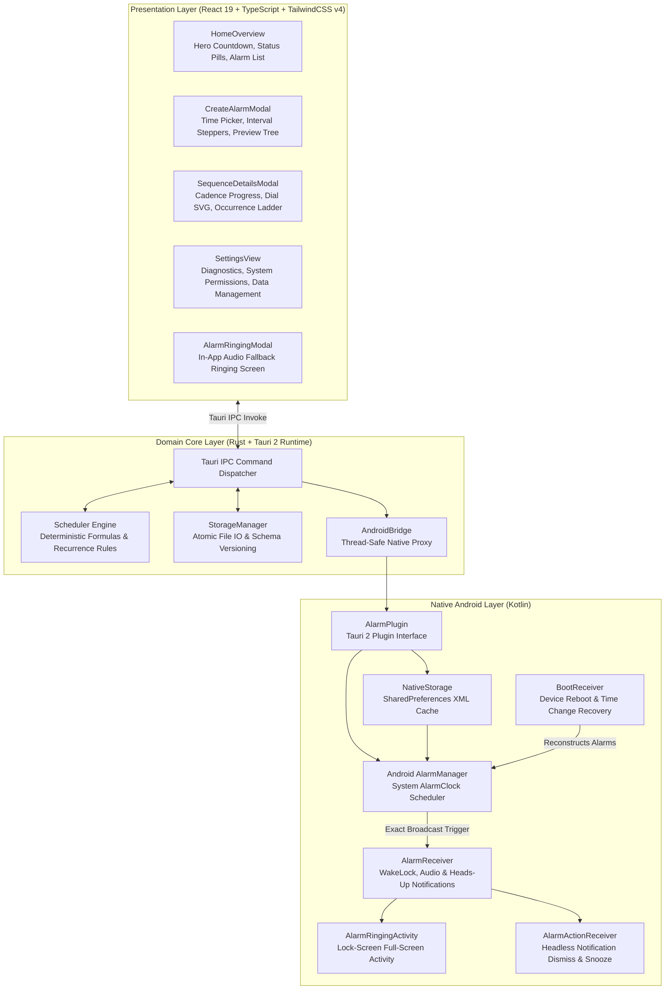

# Architecture Documentation

This document describes the software architecture, data flow, component boundaries, and scheduling algorithms of iAlarm (Interval Alarm).

---

## 1. System Overview

iAlarm is architectured as a multi-tier, offline-first hybrid mobile application. The architecture cleanly separates user presentation, domain scheduling logic, and hardware operating system interactions across three distinct layers:



---

## 2. Core Scheduling Engine (Rust)

The domain scheduling logic is encapsulated in pure, stateless Rust functions within `src-tauri/src/scheduler.rs`. This isolation allows complete deterministic unit testing independent of mobile hardware.

### 2.1 Fixed-Interval Math
A sequence is defined by an anchor start time $T_0$, an interval value $V$, an interval unit $U \in \{\text{minutes}, \text{hours}\}$, and total occurrence count $N$.

The interval duration in milliseconds $\Delta$ is calculated as:
$$\Delta = \begin{cases} V \times 60 \times 1000 & \text{if } U = \text{minutes} \\ V \times 3600 \times 1000 & \text{if } U = \text{hours} \end{cases}$$

The scheduled trigger time for occurrence index $n \in [0, N-1]$ is:
$$T(n) = T_0 + (n \times \Delta)$$

Where $n = 0$ corresponds to the initial anchor occurrence.

### 2.2 Sequence Repetition Rules
When an occurrence fires or when schedule computation executes relative to the current timestamp $T_{\text{now}}$:

1. **One-Time (`one_time`)**:
   - The engine iterates $n$ from the current sequence index to $N-1$.
   - If $T(n) > T_{\text{now}}$, occurrence $n$ is targeted.
   - If all $N$ occurrences have elapsed ($T(N-1) \le T_{\text{now}}$), the sequence state transitions to `Completed` and `enabled` is set to `false`.

2. **Daily (`daily`)**:
   - When all occurrences for day $D$ elapse, the anchor time is projected forward to the same time of day on day $D+1$.
   - The occurrence index is reset to $0$.

3. **Selected Weekdays (`weekdays`)**:
   - Evaluates active ISO weekdays (1 = Monday, 7 = Sunday).
   - Projects the anchor forward to the next matching calendar day in the selected weekday set.

4. **Continuous (`continuous`)**:
   - Automatically wraps occurrences continuously:
   $$T_0' = T_0 + k \times (N \times \Delta)$$
   where $k$ is the minimum integer such that $T_0' + (N-1)\Delta > T_{\text{now}}$.

### 2.3 Isolated Snooze Architecture
Snoozing creates an isolated temporary event without shifting the master cadence grid:
$$T_{\text{snooze}} = T_{\text{now}} + (D_{\text{snooze}} \times 60 \times 1000)$$

- The sequence state transitions to `Snoozed`.
- `snoozed_until` is updated to $T_{\text{snooze}}$.
- Subsequent fixed-interval occurrences $T(n+1), T(n+2), \dots$ retain their original absolute timestamps.

### 2.4 Downtime & Expired Occurrence Recovery
If the device was powered down across scheduled trigger times:
- Rather than sounding a rapid backlog of expired alarms upon boot, the engine evaluates:
  $$\text{target\_index} = \min \{ n \mid T(n) > T_{\text{now}} \}$$
- All expired indices $i < \text{target\_index}$ are marked completed or skipped.
- The next valid future occurrence is immediately scheduled.

---

## 3. Tauri IPC & Android Native Bridge

Communication between the web frontend, Rust domain logic, and Android Kotlin runtime operates through Tauri 2's mobile plugin infrastructure.

```text
[React TypeScript API]
        │
        ▼ (tauri.invoke)
[Rust Command: commands::create_alarm]
        │
        ├─► [StorageManager.save_alarm] ──► writes disk JSON
        │
        └─► [AndroidBridge.sync_alarms]
                    │
                    ▼ (run_mobile_plugin)
            [AlarmPlugin.kt: syncAlarms]
                    │
                    ├─► [NativeStorage.saveAlarms] ──► writes SharedPreferences
                    │
                    └─► [AlarmScheduler.rescheduleAll] ──► registers AlarmManager
```

### 3.1 Plugin Registration (`init_alarm_plugin`)
In `src-tauri/src/lib.rs`:
```rust
fn init_alarm_plugin() -> TauriPlugin<tauri::Wry> {
    Builder::new("alarm")
        .setup(|app, _api| {
            #[cfg(target_os = "android")]
            {
                let handle = _api.register_android_plugin("com.intervalalarm.alarm", "AlarmPlugin")?;
                let bridge = AndroidBridge::new(handle);
                app.manage(bridge);
            }
            #[cfg(not(target_os = "android"))]
            {
                let bridge = AndroidBridge::new();
                app.manage(bridge);
            }
            Ok(())
        })
        .build()
}
```

### 3.2 Thread-Safe Bridge Handle (`AndroidBridge`)
The `AndroidBridge` struct wraps Tauri's `PluginHandle<tauri::Wry>` and implements `Send + Sync`. This allows any Tauri command in `commands.rs` to automatically trigger native synchronization whenever an alarm is created, edited, toggled, deleted, dismissed, or snoozed:

```rust
fn sync_to_native(app: &AppHandle, storage: &StorageManager) {
    let alarms = storage.get_alarms();
    if let Ok(json) = serde_json::to_string(&alarms) {
        if let Some(bridge) = app.try_state::<AndroidBridge>() {
            let _ = bridge.sync_alarms(&json);
        }
    }
}
```

---

## 4. Native Android Subsystem

The native layer is implemented in Kotlin under `src-tauri/gen/android/app/src/main/java/com/intervalalarm/alarm/`.

### 4.1 Component Roles

| Component | Class Type | Responsibility |
|---|---|---|
| `AlarmScheduler` | Singleton Object | Computes and registers exact alarms with Android's `AlarmManager`. |
| `AlarmReceiver` | `BroadcastReceiver` | Triggered by `AlarmManager`. Acquires wake-locks, configures notification channels, starts ringtones, and launches full-screen intent. |
| `AlarmRingingActivity` | `Activity` | Full-screen activity configured to appear over the lock screen (`showWhenLocked`, `turnScreenOn`). Provides Dismiss and Snooze controls. |
| `AlarmActionReceiver` | `BroadcastReceiver` | Handles user taps on notification action buttons ("Dismiss", "Snooze") when the user interacts without unlocking. |
| `BootReceiver` | `BroadcastReceiver` | Reconstructs alarm schedules after device reboot, time changes, or package updates. |
| `NativeStorage` | Singleton Object | Persists sequence JSON in Android `SharedPreferences` to decouple alarm execution from the web process. |
| `RingtonePlayer` | Singleton Object | Manages `MediaPlayer`, system `Ringtone` fallbacks, `AudioManager` stream volumes, and haptic `Vibrator` patterns. |
| `AlarmPlugin` | `app.tauri.plugin.Plugin` | Exposes native functionality (`getAlarmPermissions`, `openAppSettings`, `getDeviceRingtone`, `syncAlarms`) to Tauri IPC. |
| `MainActivity` | `TauriActivity` | Application launch activity. Requests `POST_NOTIFICATIONS` runtime permission and ensures initial notification channel creation. |

### 4.2 Headless Execution Lifecycle
When an alarm triggers:
1. `AlarmManager` broadcasts `ACTION_TRIGGER_ALARM`.
2. Android invokes `AlarmReceiver.onReceive(context, intent)` in the application process.
3. The Chromium engine and Tauri webview do NOT need to be active.
4. `AlarmReceiver` acquires a 3-minute `SCREEN_BRIGHT_WAKE_LOCK`.
5. `RingtonePlayer.start()` raises `STREAM_ALARM` to an audible level and begins looping the device ringtone.
6. A high-priority notification with `setFullScreenIntent` launches `AlarmRingingActivity` directly over the lockscreen.
7. Upon dismissal, `AlarmScheduler` computes the subsequent occurrence and registers it with `AlarmManager`.

---

## 5. Audio and Haptics Hardware Subsystem

### 5.1 Device Ringtone Resolution
`RingtonePlayer` automatically detects the device's configured alarm sound:
```kotlin
var alarmUri = RingtoneManager.getActualDefaultRingtoneUri(context, RingtoneManager.TYPE_ALARM)
    ?: RingtoneManager.getDefaultUri(RingtoneManager.TYPE_ALARM)
    ?: RingtoneManager.getActualDefaultRingtoneUri(context, RingtoneManager.TYPE_RINGTONE)
```

### 5.2 Audio Stream Configuration
Audio playback utilizes `MediaPlayer` configured with strict alarm attributes:
- **Audio Usage**: `AudioAttributes.USAGE_ALARM`
- **Content Type**: `AudioAttributes.CONTENT_TYPE_SONIFICATION`
- **Flags**: `AudioAttributes.FLAG_AUDIBILITY_ENFORCED`
- **Volume Safeguard**: Before playback, `AudioManager.getStreamVolume(STREAM_ALARM)` is evaluated. If volume is below 70%, it is automatically elevated to 85% of hardware maximum to prevent inaudible alarms.
- **Looping**: `mediaPlayer.isLooping = true`.

### 5.3 Vibrator Patterns
Tactile feedback is coordinated through `VibratorManager` (Android 12+) or `Vibrator`:
- Pattern: `[0ms delay, 1000ms pulse, 600ms rest, 1000ms pulse, 600ms rest]`.
- Vibration effect: `VibrationEffect.createWaveform(pattern, 0)` (repeating).
