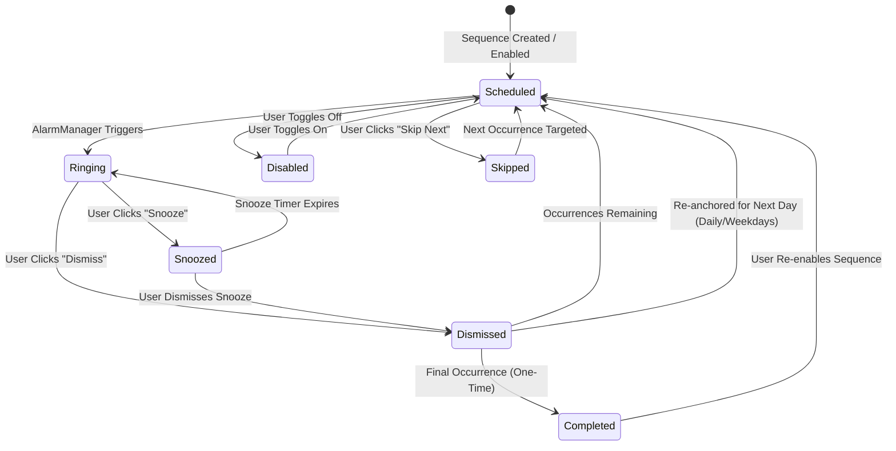

# Product Documentation

This document outlines the product vision, core problem space, functional specifications, user personas, and sequence lifecycles for iAlarm (Interval Alarm).

---

## 1. Product Vision & Mission

Standard mobile clock applications force users into manual repetition when managing recurring interval-based schedules. Creating four alarms spaced six hours apart requires configuring four separate alarms manually, calculating intermediate times mentally, and toggling all four individually when disabling or re-enabling the routine.

**iAlarm solves this through declarative interval sequences:**
Users define an anchor time, an interval step, and a count of occurrences. The engine automatically orchestrates the entire sequence natively across days and weeks.

---

## 2. Core Value Proposition

- **Single Point of Configuration**: Define a routine once (e.g., 6:00 AM, every 4 hours, 4 occurrences). The application generates 6:00 AM, 10:00 AM, 2:00 PM, and 6:00 PM automatically.
- **Atomic Sequence Management**: Toggle, edit, or delete an entire interval routine with a single switch.
- **Offline-First Native Reliability**: Alarms function without internet connectivity, without cloud dependencies, and without requiring the application interface to remain open.
- **Isolated Progression**: Snoozing or skipping a single occurrence never mutates or shifts the remaining occurrences in the sequence ladder.

---

## 3. Functional Feature Specifications

### 3.1 Anchor Time Selector
- Supports both 12-hour (AM/PM) and 24-hour time standards based on user preferences.
- Quick preset buttons:
  - **Now (+5m)**: Quick countdown timer setup.
  - **Top of Hour**: Aligns the anchor to the upcoming :00 mark.
  - **Tomorrow 7:00 AM**: Fast configuration for next-morning sequences.

### 3.2 Interval Configuration
- **Interval Values**: Integer steppers from 1 to 999.
- **Interval Units**:
  - `minutes`: Granular timing for short focus blocks, eye-rest intervals, or hydration reminders.
  - `hours`: Standard timing for medications, nutrition schedules, and shift routines.
- **Quick Preset Chips**: `30m`, `1h`, `2h`, `4h`, `6h`, `8h`, `12h`.

### 3.3 Occurrence Count & Continuous Mode
- **Finite Sequences**: Set total occurrences between 1 and 99.
- **Continuous Mode**: Toggle continuous execution. When active, after the sequence finishes its cycle, the anchor time automatically projects forward into the future, rolling indefinitely until paused.

### 3.4 Live Calculated Schedule Preview
Before saving any sequence, the application renders a real-time calculated preview tree:
- Occurrence index badge (e.g., `#1 (Anchor)`, `#2`, `#3`).
- Calculated clock time (e.g., `06:00 AM`, `12:00 PM`, `06:00 PM`, `12:00 AM`).
- Relative offset tag (e.g., `Start`, `+6h 00m`, `+12h 00m`).
- Calendar day rollover indicator (e.g., `Today`, `Tomorrow`, `+2 Days`).

### 3.5 Recurrence Modes
1. **One-Time Sequence**: Runs the configured $N$ occurrences once, then marks the sequence `Completed` and disables it.
2. **Daily Sequence**: Runs the configured sequence daily, re-anchoring to the original start time each day.
3. **Selected Weekdays**: Executes only on selected days of the week (Monday through Sunday).
4. **Continuous Repetition**: Cycles continuously across calendar days with bounded native scheduling.

### 3.6 Sequence Progress Ladder
The sequence details modal displays a visual ladder showing the operational state of every occurrence:
- **Done**: Past occurrences that have already rung or were dismissed.
- **Active Next**: The immediate upcoming occurrence with a dedicated **Skip Next Occurrence** button.
- **Queued**: Future occurrences waiting in line.

---

## 4. Sequence Lifecycle & State Machine

### State Definitions
- `Scheduled`: Sequence is active and the next occurrence is registered with `AlarmManager`.
- `Ringing`: An occurrence is currently sounding.
- `Snoozed`: Temporary one-off occurrence active; master cadence grid remains unaltered.
- `Dismissed`: Current occurrence concluded; sequence advances index to $n+1$.
- `Skipped`: User bypassed the upcoming occurrence without waiting for it to ring.
- `Completed`: All configured occurrences in a one-time sequence have concluded.
- `Disabled`: Sequence paused by user; all registered native alarms are cancelled.

---

## 5. Target User Personas & Use Cases

### 5.1 Post-Operative Medication Adherence
- **User**: Patient prescribed antibiotics required strictly every 6 hours across 5 days.
- **Routine**: Start at 6:00 AM, 6-hour interval, 4 occurrences, repeated daily.
- **Benefit**: Avoids manually creating 4 separate daily alarms and provides certainty that all 4 doses trigger on schedule.

### 5.2 Hydration & Desk Ergonomics
- **User**: Knowledge worker needing reminders to drink water and correct posture during work hours.
- **Routine**: Start at 9:00 AM, 45-minute interval, 10 occurrences, active Monday through Friday.
- **Benefit**: Automatically starts when the workday begins and halts in the evening without manual weekend intervention.

### 5.3 Polyphasic / Shift Work Sleep Scheduling
- **User**: Rotating shift nurse or night-shift worker managing non-standard sleep cycles.
- **Routine**: Start at 2:00 PM, 90-minute sleep cycles, 3 occurrences.
- **Benefit**: Easily adjust starting anchor daily; intermediate occurrences adapt automatically.

### 5.4 Intermittent Fasting & Nutritional Timing
- **User**: Athlete or fitness practitioner scheduling nutrient intake across a 16:8 feeding window.
- **Routine**: Start at 12:00 PM, 2-hour interval, 4 occurrences.
- **Benefit**: Clear visual timeline of all feeding check-ins with single-toggle reset.

---

## 6. Edge Cases & Reliability Mitigation

| Scenario | Risk | Mitigation |
|---|---|---|
| **Crossing Midnight** | Alarms scheduled across midnight might lose date alignment or schedule on the wrong day. | Rust domain engine explicitly calculates with `chrono::Duration`, incrementing date stamps and labeling preview items with relative day offsets (`Tomorrow`, `+2 Days`). |
| **Device Power-Off During Occurrence** | When phone boots back up, past occurrences might ring all at once. | `AlarmScheduler.rescheduleAll` skips past timestamps and targets only occurrences strictly in the future relative to current time. |
| **System Timezone Change** | Traveling across timezones could displace interval offsets. | `BootReceiver` listens for `ACTION_TIMEZONE_CHANGED` and recalculates upcoming trigger timestamps according to local time. |
| **Multiple Dismiss Taps** | Rapid double-tapping dismiss button might advance sequence twice. | `AlarmActionReceiver` and `AlarmRingingActivity` verify occurrence state and cancel the active notification ID atomically before updating state. |
